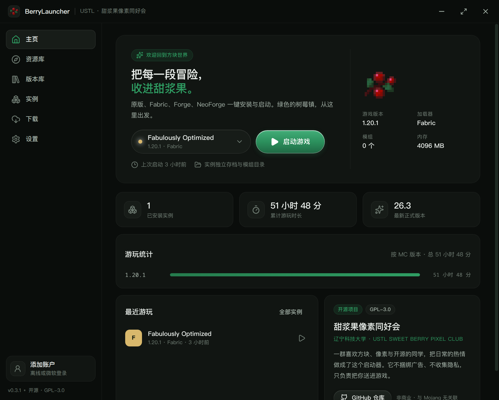
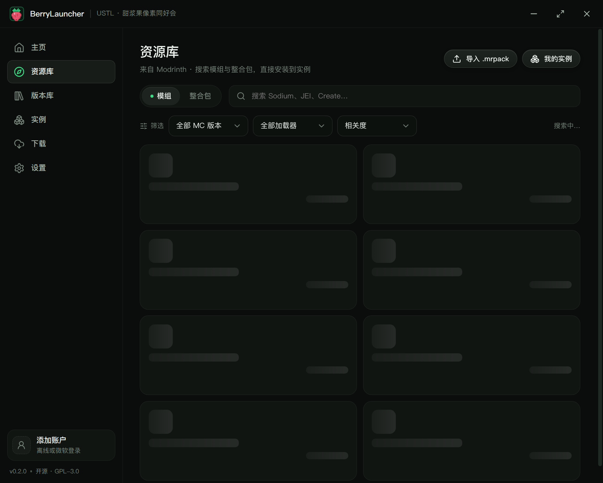
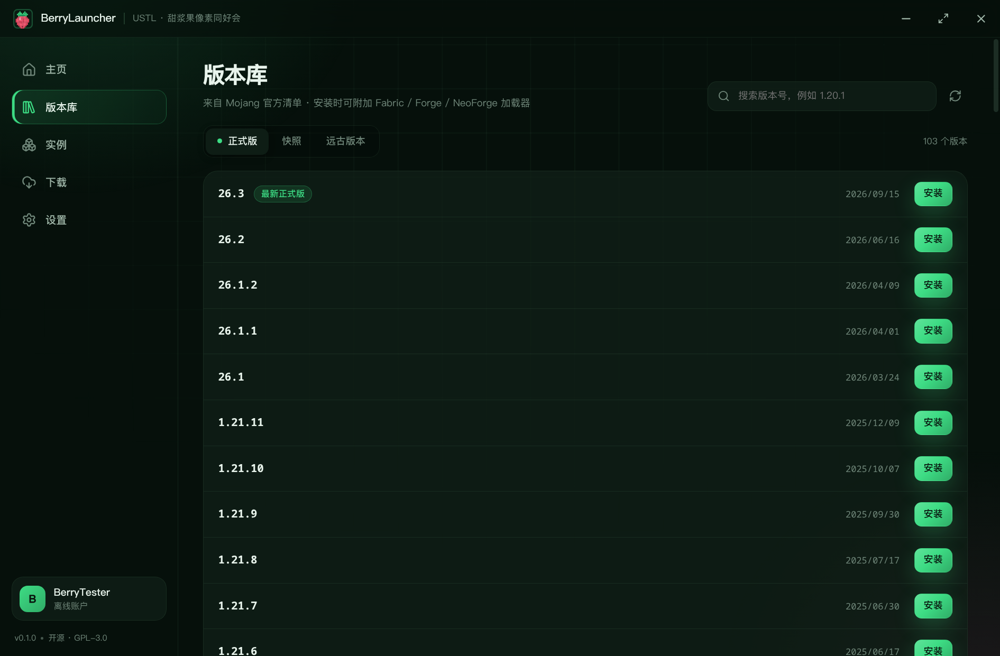
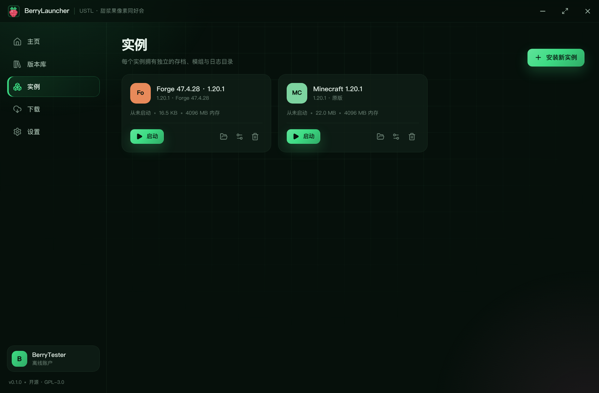
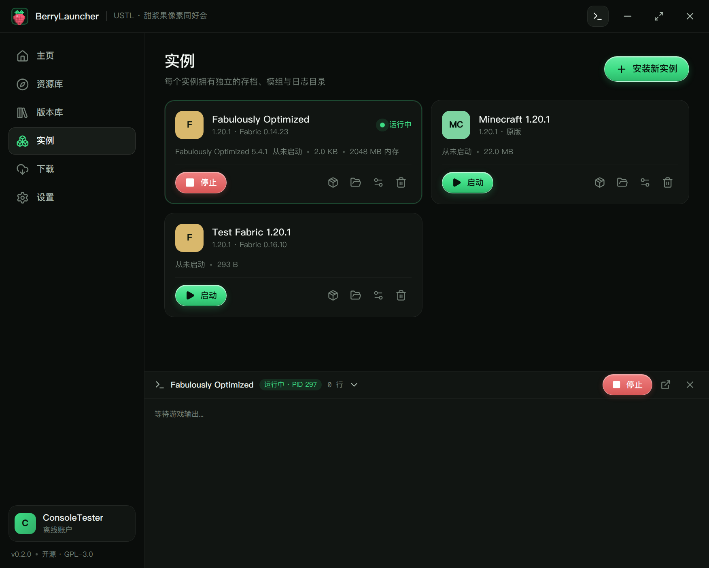
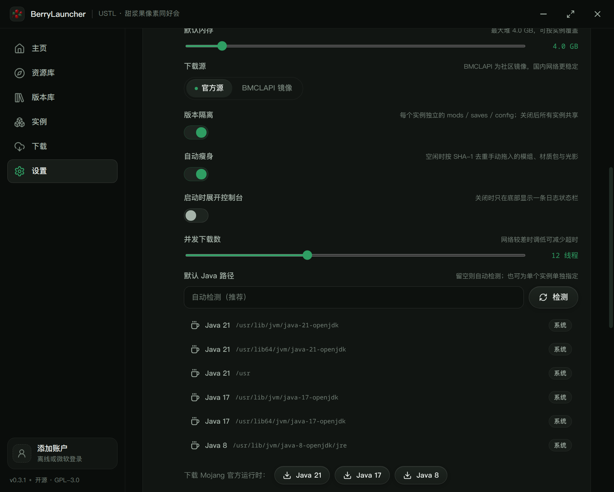

<div align="center">


# BerryLauncher · 甜浆果启动器

**辽宁科技大学「甜浆果像素同好会」开源的 Minecraft 启动器**

原生支持 Minecraft 全版本与 Fabric / Quilt / Forge / NeoForge；内置 Modrinth 模组/整合包搜索、MUA 外置登录，绿色主题、离线即用、无广告无捆绑。

[](LICENSE)
[](#平台支持)
[](https://www.electronjs.org/)

</div>

---

## 这是什么

BerryLauncher 是一个面向玩家、也面向同好会内部使用的 Minecraft 启动器：

- **Windows 优先**：第一版以 Windows 10/11 x64 为主要目标，安装包开箱即用。
- **跨平台架构**：主进程通过 `src/main/paths.ts` / 平台检测层隔离系统差异，Linux 与 macOS 的打包已在路线图中。
- **不参考 HMCL**：启动、安装、下载与 UI 逻辑均为独立实现。
- **开源非商业**：GPL-3.0-or-later，不收集隐私、不注入广告、不捆绑第三方软件。

## 功能

### 游戏版本

- 从 Mojang 官方清单拉取全部版本（正式版 / 快照 / 远古版本），支持搜索与分类浏览。
- 一键安装原版客户端：版本 JSON、客户端 jar、依赖库、资源索引与数千个资源文件全部自动校验（SHA-1）。
- 安装记录与文件校验可重复执行，损坏的文件会被重新下载。

### 模组加载器

| 加载器 | 安装方式 | 说明 |
| --- | --- | --- |
| Fabric | Fabric Meta 官方 profile | 轻量、更新快 |
| Quilt | Quilt Meta 官方 profile | Fabric 生态分支 |
| Forge | **官方安装器无头模式** | 覆盖 1.12.2 至最新版本 |
| NeoForge | **官方安装器无头模式** | 1.20.2+ 的新式加载器 |

Forge / NeoForge 使用官方 installer 的 `--installClient` 无头模式，自动补齐处理器、映射与依赖，避免自行复刻 Forge 的处理器链导致版本兼容问题。

### 版本隔离与资源实体库

- 设置里的「版本隔离」开关默认开启：每个实例独立 `mods / saves / config`；关闭后共享根目录，整合包实例始终强制隔离。
- 所有 mod、材质包、光影按 SHA-1 只存一份实体（`<dataDir>/resources`），实例里放只读硬链接；跨卷/exFAT 自动退化为复制。
- 可选「自动瘦身」：空闲时扫描手动拖进文件夹的资源并去重；默认关闭，首次会提示一次。
- 支持导出实例中被修改/新增的资源：整文件 + `berry-resource-manifest.json` 变更清单。

### 游玩时长

- 独立 `playtime.json` 账本，20 秒心跳，启动器崩溃后按最后心跳恢复，不再只在退出时记一笔。
- 主页显示总时长和按 MC 版本的柱状统计；实例卡保留最近游玩时间。

### 资源库（Modrinth）

- 模组 / 整合包搜索：按 Minecraft 版本、加载器（Fabric / Quilt / Forge / NeoForge）、相关度 / 下载量 / 关注数筛选。
- 一键安装到指定实例，自动解析 required 依赖、按实例版本与加载器校验，SHA-1 校验后写入 `mods/`。
- 实例内模组管理：启用 / 禁用（`.jar` ↔ `.jar.disabled`）、删除、打开目录。
- 支持导入本地 `.mrpack`，也支持从 Modrinth 直接安装整合包。

### 整合包

- 解析 `modrinth.index.json`，自动安装对应的 Minecraft 与加载器。
- 下载 `files[]`（校验 SHA-1，跳过 `env.client = unsupported`），释放 `overrides/` 与 `client-overrides/`。
- 实例卡片显示整合包名称与版本，保留独立的存档与模组目录。

### 启动与账户

- 离线账户开箱即用（单人游戏 / 局域网）。
- 微软账户：OAuth 2.0 设备码流程 → Xbox Live → XSTS → Minecraft Services，自动刷新令牌。
- **MUA 高校联盟 / authlib-injector 外置登录**：用户名密码只用于向认证服务器换取令牌，不落盘；启动时自动注入 authlib-injector。
- 每个实例独立存档、模组、资源包目录；共享 `libraries` / `assets`，不重复占用磁盘。
- Java 自动检测（系统 JDK / Mojang 运行时），缺失时可一键下载 Java 8 / 17 / 21。
- 实时启动日志、退出码提示、进程树停止（Windows 下 `taskkill /T`）。

### 体验

- 设计语言 v2「静林」：纯色平面 + 凸起控件、固定森林绿、深浅色模式，规范见 [docs/DESIGN.md](docs/DESIGN.md)。
- 启动日志改为内容区内的 dock：`peek` 状态条 / 展开 / 完全隐藏三态，不遮挡侧栏账户卡；标题栏终端图标可随时重新打开。
- 支持含中文 / 非 ASCII 字符的安装路径与游戏目录；Electron 44 + Unicode classpath/参数测试。
- 官方源 / BMCLAPI 镜像一键切换（国内下载加速）。
- 并发下载、速度与进度展示、任务取消。
- 版本库、资源库、实例、下载、设置、主页六个主页面，全部零外部 UI 框架手写样式。

## 截图

> 截图来自 Linux 开发环境；Windows 下布局一致，窗口边框由系统绘制。

| 主页 | 资源库 |
| --- | --- |
|  |  |

| 版本库 | 实例 |
| --- | --- |
|  |  |

| 启动控制台 | 设置 |
| --- | --- |
|  |  |

## 快速开始（开发）

要求：Node.js ≥ 20、npm ≥ 10，以及一个可用的桌面会话。

```bash
git clone https://github.com/USTL-SweetBerry/berrylauncher.git
cd berrylauncher
npm install
npm run dev          # Vite + Electron 热更新
```

只想跑构建产物：

```bash
npm run build
npx electron .       # 或 npm start
```

> 若 `npm install` 阶段跳过了 Electron 的二进制下载（npm 的 install-scripts 策略），
> 执行 `node node_modules/electron/install.js`，或设置
> `electron_config_cache` 指向可写目录后重试。

### 目录结构

```
src/
  main/                 Electron 主进程
    services/           由 ipc.ts 组装的核心服务
    versions.ts         版本清单、原版安装、继承链合并、natives 提取
    loaders.ts          Fabric/Quilt/Forge/NeoForge 列表与安装
    launch.ts           参数展开、classpath、进程与日志
    accounts.ts         离线 / 微软 / MUA 账户与令牌刷新
    modrinth.ts         Modrinth 搜索、项目、版本与依赖
    mods.ts             模组安装、启用/禁用、删除与本地索引
    modpacks.ts         .mrpack 解析、整合包实例安装
    resources.ts        资源实体库、硬链接去重、自动瘦身、修改导出
    playtime.ts         游玩时长账本、心跳与按版本聚合
    authlib.ts          authlib-injector 下载与校验
    download.ts         并发下载器（重试 / SHA-1 / 进度）
    java.ts             运行时探测与 Mojang JRE 下载
  preload/              contextBridge，类型化 IPC 桥
  renderer/             React UI（无 UI 框架，手写 CSS 设计系统）
  shared/               主进程与渲染进程共享的类型与常量
scripts/                dev 编排、图标生成、端到端冒烟测试
```

数据目录（默认）：

| 平台 | 位置 |
| --- | --- |
| Windows | `%APPDATA%\BerryLauncher` |
| Linux | `~/.config/BerryLauncher` |
| macOS | `~/Library/Application Support/BerryLauncher` |

其中 `minecraft/` 为游戏数据根目录（`versions/`、`libraries/`、`assets/`、`instances/<id>/`），
`runtime/` 为下载的 Java，`logs/` 为启动器与游戏日志。

可用环境变量 `BERRY_DATA_DIR` 覆盖数据目录，方便做便携版或测试隔离。

## 构建 Windows 安装包

```bash
# 任意平台：免安装 zip（解压后运行 BerryLauncher.exe）
npm run dist:win

# Windows / 装有 Wine 的环境：NSIS 安装包
npm run dist:win:installer

# Windows CI：安装包 + zip（自动写入 exe 图标与版本信息）
npm run dist:win:native
```

产物在 `release/`。在 Linux 上交叉构建时，`win.signAndEditExecutable=false` 会跳过
rcedit（因此 exe 使用 Electron 默认图标），安装包（NSIS）需要 Wine 才能生成；
仓库内的 GitHub Actions 工作流在 `windows-latest` 上产出带完整图标的安装包。

Linux 构建：`npm run dist:linux`（AppImage）。

### 平台支持

| 平台 | 状态 | 说明 |
| --- | --- | --- |
| Windows 10/11 x64 | ✅ 第一优先 | 已产出免安装 zip（`release/`）；Windows 专属路径、进程树停止、无控制台启动已实现，群友 Windows 真机烟测已通过 |
| Linux x64 | ✅ 开发可用 | 已在 Arch Linux 跑通安装、启动、Forge 安装与 BootstrapLauncher 加载（软件渲染环境） |
| macOS | 🚧 代码就绪、未验证 | 已提供 dmg 配置，需要真机验证 Java 与窗口行为 |

## 微软登录配置

启动器不内置任何 Azure 应用凭据。想使用正版登录，需要自己注册一个免费应用（约两分钟）：

1. 打开 [Azure 门户 → 应用注册](https://portal.azure.com/#view/Microsoft_AAD_IAM/ActiveDirectoryMenuBlade/~/RegisteredApps)，新建注册。
2. 账户类型选择「仅个人 Microsoft 账户」或「任何组织目录 + 个人账户」，重定向 URI 选「公共客户端/本机」。
3. 在「身份验证」中启用 **允许公共客户端流**。
4. 复制「应用程序(客户端) ID」，填入 设置 → 账户与登录 → 微软登录 Client ID。
5. 回到账户对话框，点「开始微软登录」，按提示在浏览器输入设备码。

Client ID 不是密钥，可安全保存在本地配置文件中；令牌仅存于 `accounts.json`（权限 0600），不经过任何第三方服务器。

> 离线账户无需任何配置，安装完版本即可启动。

## 已知限制

- Windows 包在 Linux 上交叉构建，尚未在 Windows 真机冒烟；首次发布前建议在 Windows 10/11 上跑一遍安装与启动。
- CurseForge 在线搜索需要 API Key，当前只做 Modrinth 在线；本地导入目前支持 `.mrpack`，CurseForge zip 在路线图中。
- 资源去重依赖同卷硬链接；游戏目录和启动器数据目录跨盘时只保留原文件，不产生额外副本。
- 同时运行多个实例时总游玩时长按各自运行时间相加；启动器退出后游戏若继续运行，后续时间不计入。
- 资源实体设为只读；要修改请使用「复制到实例并解锁」流程（UI 随后接入）。
- MUA 登录需要真实账户；密码不会保存，但令牌会以 0600 权限写入 `accounts.json`。
- 远古版本（1.5 及更早）使用旧资源索引，当前会给出明确提示而不是静默失败。
- 微软登录依赖用户自备 Client ID。
- 暂无模组市场 / 整合包导入 / 自动更新；这些在路线图中。
- 安装 Forge / NeoForge 时耗时取决于官方安装器与网络，界面会实时显示安装器输出摘要。

## 路线图

- [ ] macOS / Linux 正式安装包与签名
- [x] Modrinth 模组搜索、安装与实例内管理
- [x] Modrinth `.mrpack` 整合包在线安装 / 本地导入
- [x] MUA 高校联盟外置登录
- [ ] CurseForge 在线搜索（用户自备 API Key）与 CurseForge zip 导入
- [ ] 模组更新检查、实例导出
- [ ] 控制台日志搜索与高度拖拽
- [x] 版本隔离、资源实体库与自动瘦身
- [x] 游玩时长统计（实例 / MC 版本 / 总计）
- [ ] 自动更新与增量下载
- [ ] 多语言（当前为简体中文）
- [ ] 皮肤预览与正版服务器状态

## 参与贡献

欢迎同好会的同学提 Issue / PR。提交前请至少跑通：

```bash
npm run typecheck
npm run build
```

涉及启动链路的改动，建议再跑一次端到端冒烟（会真实下载并启动游戏，需图形会话）：

```bash
npm run e2e
# 复用已下载数据并额外安装 Forge：
BERRY_E2E_DATA=./.e2e-data BERRY_E2E_FORGE=1 npm run e2e
```

## 声明

- 本项目由 **辽宁科技大学 甜浆果像素同好会（USTL Sweet Berry Pixel Club）** 发起并维护。
- 与 Mojang Studios、Microsoft 无隶属或背书关系；Minecraft 是 Mojang 的商标。
- 启动器不附带、不分发任何游戏本体或模组文件，所有内容均从官方/作者提供的地址下载。
- Forge / NeoForge 安装器版权归其作者所有；请尊重上游项目的下载与赞助说明。

## 许可证

[GPL-3.0-or-later](LICENSE) © 2026 USTL Sweet Berry Pixel Club
